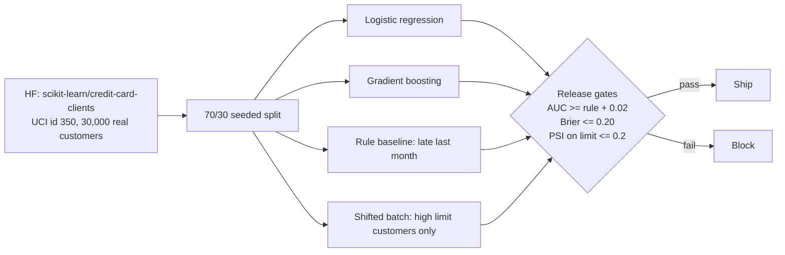
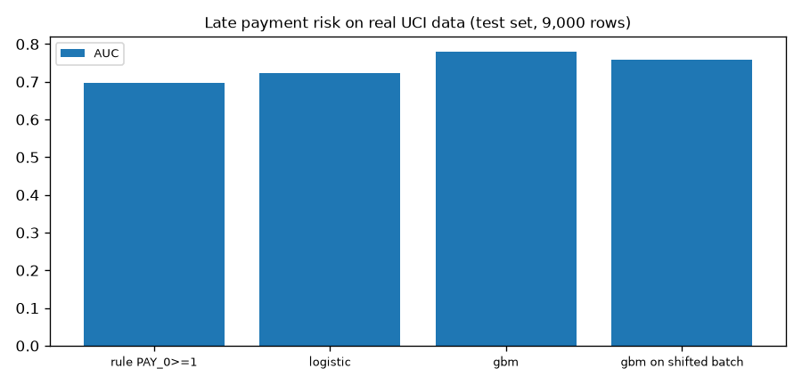
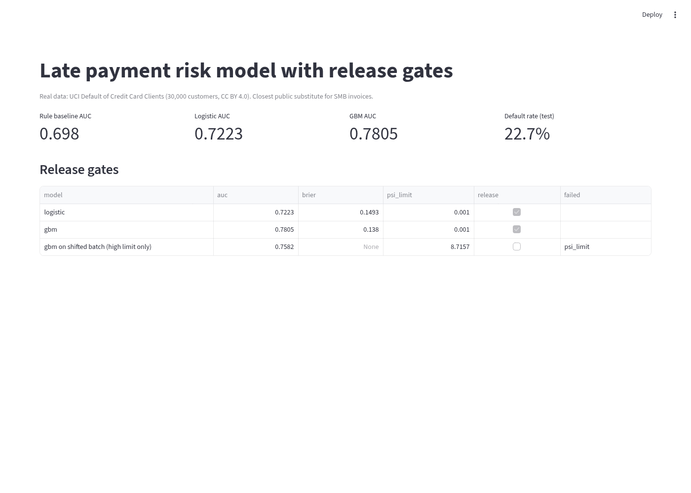

# Late payment risk model with release gates (real data)

Score the risk that a customer pays late, and only ship a model that passes clear gates. Now on real public credit data.

## Data (real, with sources)
- **Default of Credit Card Clients** (Yeh and Lien 2009), UCI Machine Learning Repository id 350, **CC BY 4.0**. CSV from https://huggingface.co/datasets/scikit-learn/credit-card-clients (card says CC0). 30,000 real customers in Taiwan, April to September 2005. Target: default next month (22.7% in test).
- **Why a substitute:** I found no public dataset of real small business invoices with payment outcomes and a clear licence (the IBM accounts receivable sample is no longer at its GitHub URL and has no stated licence). This dataset has the same shape of problem: past repayment delays, amounts owed, amounts paid, and a late or not label.
- SEX, MARRIAGE and EDUCATION are not used as features.
- The old synthetic generator is kept as `risk/data_synthetic.py`, labelled SYNTHETIC.

## Architecture

More detail in [docs/architecture.md](docs/architecture.md).

## Design tradeoffs
| Decision | Why | Tradeoff |
|---|---|---|
| Gate against the simple rule, not a fixed AUC | Real data has no known best possible AUC | A weak rule makes the gate easy to pass |
| Drop SEX, MARRIAGE, EDUCATION | Avoid using protected traits | May lose a little AUC |
| PSI on credit limit as the drift gate | Simple and explainable | Very sensitive on cut subgroups, see error analysis |
| No LLM | This is tabular scoring; a 3B chat model on numbers is not a fair or useful baseline | No LLM numbers for this repo |

## Results
| Model | AUC | Brier | Gate |
|---|---|---|---|
| Rule: late last month | 0.698 | - | baseline |
| Logistic regression | 0.7223 | 0.1493 | released |
| Gradient boosting | 0.7805 | 0.138 | released |
| GBM on shifted batch (2,349 high limit customers) | 0.7582 | - | blocked, PSI 8.7157 |

Train 21,000, test 9,000, seed 0. `python -m risk.train` writes `docs/results.json`.



## Error analysis
- Gradient boosting clearly beats logistic regression here (0.781 vs 0.722). On the old synthetic data logistic won because the data was made from a logistic formula. Real data is not.
- The drift gate blocked the high limit batch, but the model still had AUC 0.758 on it. So this block was a false alarm: PSI goes very large (8.7) when a batch is a cut of one feature. A real gate should also check live AUC once labels arrive.
- The rule baseline is strong (0.698) because last month's status carries most of the signal.

## Limitations
- Consumer credit cards, not business invoices.
- Data from 2005, one country.
- Random split, not a time split.
- No calibration step and no fairness audit beyond dropping fields.

## UI


## How to run
```bash
pip install -r requirements.txt   # pandas, scikit-learn, streamlit
bash scripts/download_data.sh     # real UCI CSV from Hugging Face
python -m risk.train
pytest -q
streamlit run app/streamlit_app.py
```
