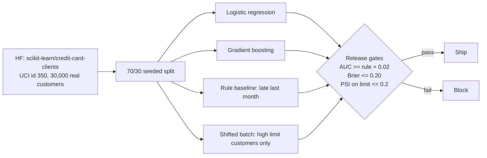

# Architecture

## Data sources

- **Default of Credit Card Clients** (Yeh and Lien 2009), UCI Machine Learning Repository id 350, **CC BY 4.0**. CSV from https://huggingface.co/datasets/scikit-learn/credit-card-clients (card says CC0). 30,000 real customers in Taiwan, April to September 2005. Target: default next month (22.7% in test).
- **Why a substitute:** I found no public dataset of real small business invoices with payment outcomes and a clear licence (the IBM accounts receivable sample is no longer at its GitHub URL and has no stated licence). This dataset has the same shape of problem: past repayment delays, amounts owed, amounts paid, and a late or not label.
- SEX, MARRIAGE and EDUCATION are not used as features.
- The old synthetic generator is kept as `risk/data_synthetic.py`, labelled SYNTHETIC.

## Design tradeoffs

| Decision | Why | Tradeoff |
|---|---|---|
| Gate against the simple rule, not a fixed AUC | Real data has no known best possible AUC | A weak rule makes the gate easy to pass |
| Drop SEX, MARRIAGE, EDUCATION | Avoid using protected traits | May lose a little AUC |
| PSI on credit limit as the drift gate | Simple and explainable | Very sensitive on cut subgroups, see error analysis |
| No LLM | This is tabular scoring; a 3B chat model on numbers is not a fair or useful baseline | No LLM numbers for this repo |

## Limitations

- Consumer credit cards, not business invoices.
- Data from 2005, one country.
- Random split, not a time split.
- No calibration step and no fairness audit beyond dropping fields.
